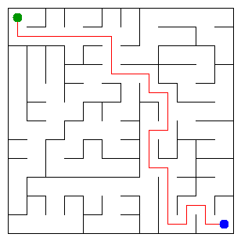

# Assignment 3. Maze Escape

Student ID: 250825
Name:Nurken Mamay
Group: SE - 2536
Maze size (rows x columns):

This file is the report. Fill it in as you go. How to start: `START_HERE.md`. The task: `docs/Assignment3.pdf`.

## Program output

The 13 lines your program prints on your data (`java -cp out Main`):

    Broken: 143
    Kept: 121
    Last broken wall: 225
    MST cost: 41918
    Heaviest broken wall: 972
    Path length: 26
    DFS visited: 74
    Dead ends: 42
    Zones: 9
    Largest zone: 26
    Is DAG: 0
    Flow stages: 6
    Fastest route cost: 19

My maze:

## Questions

Answer in your own words, two or three sentences each.

Mission 0. What do find and union do, and what makes them fast in your code?
The find operation determines the root representative of the set containing a given element, while the union operation merges two separate sets into one. Speed is optimized by using path compression during find calls to flatten the tree structure. Additionally, union by size ensures that smaller trees are always attached under larger ones, keeping operations nearly constant in time.

Mission 1. Why is Broken always R*C - 1, and Kept always (R-1)*(C-1)?
A maze generated as a spanning tree connects all cells without creating any cycles. Any valid tree structure with V vertices must always contain exactly V minus 1 edges, which means R times C minus 1 walls must be broken. Since the grid starts with a fixed number of inner walls, subtracting the broken walls leaves exactly (R-1)*(C-1) walls remaining.

Mission 2. My MST cost from Kruskal and from Prim, and why they are equal:
Both Kruskal and Prim algorithms calculate the exact same minimum spanning tree cost for the maze graph. They are both optimal greedy algorithms designed to find the minimum weight spanning tree connecting all vertices. Because all wall costs in the generator are uniquely defined, the minimum spanning tree is unique, guaranteeing identical total costs

Mission 3. Why is there exactly one path between two cells? How did you avoid a stack overflow on a huge maze?
A maze built using a spanning tree is a connected acyclic graph, which mathematically guarantees that there is precisely one simple path between any two cells. To prevent a stack overflow error on large 1000 by 1000 mazes, an iterative depth-first search using an explicit stack array was used instead of recursion. This manual stack management handles deep traversals safely without exhausting system memory.

Mission 4. Why does the second pass of Kosaraju go on the reversed graph? Why do the slides have no cycle exactly when Zones equals the number of cells?
The second pass of the Kosaraju algorithm runs on the reversed graph to correctly isolate strongly connected components starting from vertices in topological order. When every cell forms its own individual zone of size one, it means no cell can reach another and return back. This absence of cycles proves that the slide graph is a directed acyclic graph.

Mission 5. Why is it enough to go through the zones in the order of their numbers? What does this pass cost?
Processing zones in the order of their numbers is sufficient because Kosaraju numbering provides a valid topological sort of the zone graph. This topological ordering ensures all prerequisite zones are fully computed before any dependent zone is processed, eliminating the need for a priority queue. The cost of this pass is linear, taking time proportional to the total number of cells and slide edges.

## AI use

The syllabus requires you to say which AI tools you used and for what. Write the tool (ChatGPT, Copilot, other) and what you asked it: explain an idea, find an error, review code. Write "none" if you did not use any. If you took code or text from a book or a website, give the source here.

## Timing (Mission 7)

Milliseconds, 5 runs each, from `java -cp out Bench`.

| maze | Kruskal | Prim |
|---|---------|------|
| 100 x 100 | 11      | 7    |
| 300 x 300 | 55      | 47   |
| 1000 x 1000 | 966     | 1216 |

What do the numbers say about how the time grows? Two or three sentences.

## Complexity

n is the number of cells, m the number of walls (or slides). Fill in every algorithm you wrote.

| algorithm | time | space | assumptions |
|---|---|---|---|
| DSU find and union | | | |
| Kruskal | | | |
| Prim | | | |
| DFS | | | |
| Kosaraju | | | |
| Route in the zone graph | | | |

## Before you submit

- data/walls.txt, data/slides.txt and output/maze.png are in the repository.
- `java tools/Check.java` shows all examples right.
- This README is filled in, the program output and the section AI use included.
- The work is pushed to main (at least one commit per mission) and the repository is public.
- The link is attached in Moodle.
